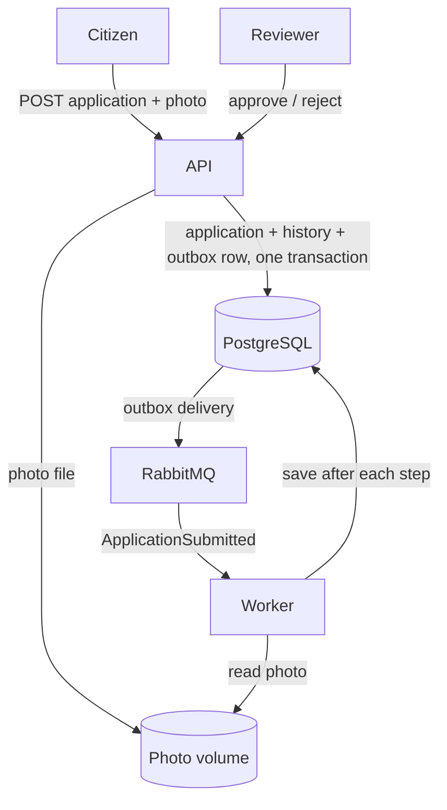
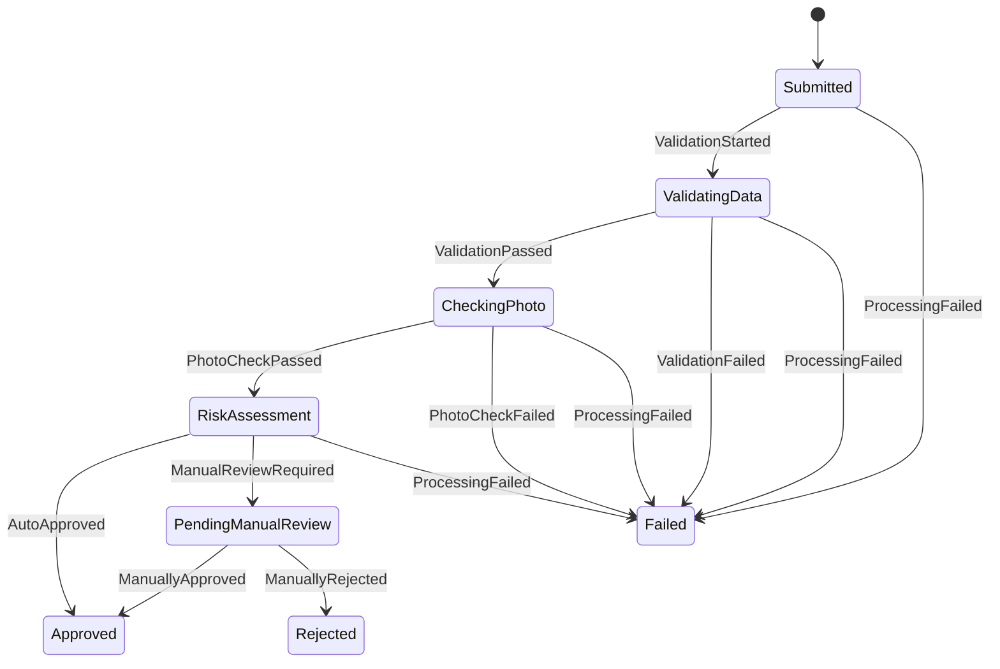

# Driving Licence Onboarding Workflow

A .NET 10 backend for submitting driving licence applications and processing them through an asynchronous, audited workflow: data validation, a simulated photo check and a risk assessment, ending in automatic approval, manual review, rejection or failure.

**Stack:** ASP.NET Core Web API · Worker Service · PostgreSQL + EF Core · RabbitMQ + MassTransit (v8)[v9 and above is commercial] · Docker Compose · Serilog · OpenTelemetry · xUnit + Testcontainers · Aspire (local development only)

---

## Quick start

Requirements: Docker. The .NET 10 SDK is only needed to run the tests or develop locally.

```bash
docker compose up --build
```

| What | Where |
|---|---|
| Swagger UI | http://localhost:8080/swagger |
| Health check | http://localhost:8080/health |
| RabbitMQ management | http://localhost:15672 (user `licensing`, password `licensing`) |
| Postgres | `localhost:5432`, database `licensing` (user `postgres`, password `postgres`) |

`docker compose down -v` removes all data for a clean start.

### Running the tests

```bash
dotnet test tests/Licensing.Domain.Tests         # fast, no dependencies
dotnet test tests/Licensing.IntegrationTests     # needs Docker running
```

### Local development with Aspire (optional)

```bash
dotnet run --project src/Licensing.AppHost
```

This starts the same four services and opens the Aspire dashboard, which shows a single distributed trace for each application, from the HTTP request through RabbitMQ to every workflow step. Docker Compose remains the supported way to run the project; Aspire is a development convenience.

---

## Using the API

| Method | Endpoint | Purpose |
|---|---|---|
| `POST` | `/api/applications` | Submit an application (multipart form). Returns **202 Accepted** with the ID and status `Submitted`. |
| `GET` | `/api/applications/{id}` | Current status |
| `GET` | `/api/applications/{id}/history` | Full audit trail |
| `POST` | `/api/applications/{id}/approve` | Manual approval, only from `PendingManualReview` |
| `POST` | `/api/applications/{id}/reject` | Manual rejection with an optional reason, only from `PendingManualReview` |

Submit an application:

```bash
curl -X POST http://localhost:8080/api/applications \
  -F FirstName=John -F LastName=Doe -F DateOfBirth=1990-05-20 \
  -F NationalId=AB123456 -F Email=john.doe@example.com \
  -F PhoneNumber=+306900000000 -F "Address=Example Street 10" \
  -F LicenceCategory=B -F "Photo=@face.jpg;type=image/jpeg"
```

Reject an application in manual review:

```bash
curl -X POST http://localhost:8080/api/applications/{id}/reject \
  -H "X-Reviewer-Id: reviewer-1" -H "Content-Type: application/json" \
  -d '{"reason":"Photo does not meet quality requirements"}'
```

Dates use ISO 8601 (`yyyy-MM-dd`). The `X-Reviewer-Id` header identifies the reviewer in the audit trail; it stands in for authentication (see *Production improvements*).

To see each outcome:

- **Automatic approval:** a valid applicant aged 21 or over, category B, with a JPEG or PNG over 10 KB. The photo score is simulated from the file's bytes, so some images score below the auto-approval threshold and go to manual review; try another image.
- **Manual review:** the same with a date of birth under 21 years ago, or a category other than B.
- **Failure:** an invalid email such as `bad`, or no photo.

---

## Architecture



The API never runs the workflow. It stores the application and an outbox message in **one transaction**, returns immediately, and MassTransit's outbox delivery publishes `ApplicationSubmitted` to RabbitMQ. The Worker consumes it and advances the application one step at a time, committing after every transition.

### Projects

| Project | Responsibility |
|---|---|
| `Licensing.Domain` | Entities, value objects, state machine, business rules, workflow runner. No infrastructure dependencies. |
| `Licensing.Contracts` | Message contracts shared by the API and Worker (`ApplicationSubmitted`). |
| `Licensing.Infrastructure` | EF Core mapping and migrations, photo storage, MassTransit configuration, DI registration. |
| `Licensing.Api` | HTTP endpoints (controllers), Swagger, migrations on startup. |
| `Licensing.Worker` | MassTransit consumers that run the workflow. |
| `Licensing.ServiceDefaults` | Shared OpenTelemetry, health checks and resilience setup. |
| `Licensing.AppHost` | Aspire orchestration for local development. |
| `*.Tests` | Domain unit tests and end-to-end integration tests. |

Dependencies point inward: Domain and Contracts reference nothing; the API and Worker never reference each other.

---

## Workflow and state machine



**Approach: a custom state machine in the domain.** `WorkflowStateMachine` holds an explicit table of the 13 allowed `(status, trigger) → status` transitions. Anything not in the table throws `InvalidTransitionException`.

- **Triggers, not target statuses.** Callers report *what happened* (`ValidationPassed`) and the table decides where it leads, so code can't move an application to an arbitrary status.
- **One way to change status.** `Application.Status` has a private setter; `Application.Fire` is the only method that changes it, and it appends the audit entry in the same call. Status and history can't drift apart.
- **Check before change.** `Fire` looks up the transition before touching any field, so a rejected transition leaves the application untouched.
- **Fully testable.** One test theory checks all 88 combinations of status and trigger.

**Why not a framework** (MassTransit saga state machine, Elsa, Temporal)? The workflow is linear, short and owned by one aggregate. A transition table is about 30 lines, trivially testable and easy to explain. A saga would spread the logic across message correlation; Temporal or Elsa would add infrastructure out of proportion to the problem. A workflow with long waits, timers or compensation across services would change that judgement.

**Running the workflow.** `ApplicationWorkflow.TryAdvanceAsync` performs exactly one transition, chosen from the current status alone, and returns `false` when nothing automated is left (manual review or a terminal status). The Worker loops: advance, save, repeat. There's no "where was I" state outside the database.

**Failed vs Rejected.** `Failed` means automated checks failed or processing broke; `Rejected` means a human reviewer decided no.

---

## Business rules (simulated)

| Step | Outcome | Rules |
|---|---|---|
| Data validation | `Failed` if any rule fails | Required fields missing (including whitespace-only), invalid email, missing national ID, under 18, date of birth in the future |
| Photo check | `Failed` if any rule fails | No photo, type other than JPEG/PNG, under 10 KB, quality score below **0.3** |
| Risk assessment | `PendingManualReview` if any rule triggers | Under 21, category other than B, national ID on the watchlist, quality score below **0.6** |

Every rule set collects **all** reasons, which are recorded in the audit entry's `details`.

**Two photo thresholds.** Below 0.3 the photo is unusable and the check fails. Between 0.3 and 0.6 it's usable but doubtful, so a reviewer decides. At 0.6 or above it's fine for auto-approval.

**Simulated quality score.** A random value between 0 and 1, generated once per application. It's saved in the same commit as the photo check transition, so it can never change after the outcome is recorded.

The watchlist, thresholds, age limit and auto-approved categories are configurable in the `Risk` and `PhotoCheck` sections of `appsettings.json` (or environment variables, e.g. `Risk__Watchlist__0`).

---

## Key design decisions and trade-offs

**Photo upload: multipart/form-data** in a single request, with form field names matching the spec's JSON. It's the standard HTTP mechanism for files and is supported directly by Swagger, Postman and curl. Base64 in JSON would add about 33% to the payload and hold it in memory as one string; a separate upload endpoint would need two calls and a "no photo yet" state. The trade-off is that the request isn't pure JSON.

**Where validation happens.** The API only rejects input it can't parse (a malformed date or unknown category returns 400). Business validation (missing fields, invalid email, age) happens in the workflow, so failures are recorded in the audit trail as the spec requires. For the same reason, all `PersonalDetails` fields are nullable.

**202 Accepted on submit.** The application is stored but not yet processed; 202 with a `Location` header pointing at the status endpoint describes that precisely.

**One model for domain and persistence.** The domain classes are mapped directly by EF Core through `IEntityTypeConfiguration` classes in Infrastructure. The domain has no persistence attributes, only private parameterless constructors and a concurrency token. `PersonalDetails` and `Photo` are mapped as EF Core complex types (value objects stored as columns on `applications`). Separate persistence models would duplicate every field for no benefit at this size.

**Messages carry only the ID.** `ApplicationSubmitted` contains just the application ID. The Worker always loads current state from the database, so a message can't be stale, and no personal data passes through RabbitMQ.

**Enums stored as strings** for readable data and so adding a value never changes the meaning of existing rows. Table and column names use snake_case (EFCore.NamingConventions), the Postgres convention.

**MassTransit v8.** MassTransit v9 is commercially licensed; v8 remains open source with security patches through 2026. v8 is the right choice for this assignment. Beyond 2026, production would need a v9 licence or an alternative such as Wolverine or Rebus; the messaging design would stay the same.

**Logging.** Serilog writes structured JSON to the console in both services. The consumer adds `ApplicationId` as a log scope, so every log line for an application, including EF Core's and MassTransit's, can be filtered by it. Logs are also exported through OpenTelemetry to the Aspire dashboard when running under Aspire.

---

## Reliability

**What happens if the same message is processed twice?**
Nothing. The consumer loads the application and `TryAdvanceAsync` acts only on its current status. A duplicate for an application already past a step, waiting for review or finished does nothing and saves nothing. This is covered by unit tests. If two copies run concurrently, both load the same version; the first save wins and the second fails on Postgres's `xmin` concurrency check (`DbUpdateConcurrencyException`). MassTransit retries it, the retry sees the new status, and does nothing.

**What happens if the API saves the application but fails to publish the message?**
It can't happen partially. The API uses MassTransit's **transactional outbox**: `Publish` writes the message to an outbox table, and `SaveChangesAsync` commits the application, its first audit entry and the outbox row in one transaction. A background delivery service then publishes it to RabbitMQ and retries until the broker is reachable. If RabbitMQ is down, submissions still succeed and messages wait in the table. Delivery is at-least-once, which is why consumers are idempotent.

**What happens if the worker crashes during processing?**
The message isn't acknowledged, so RabbitMQ redelivers it. Every transition was committed separately, so the consumer resumes from the last saved status rather than starting over. The photo score is stored once computed, so it isn't recalculated.

**How are invalid workflow transitions prevented?**
By the transition table: status can only change through `Application.Fire`, which throws for any pair not in the table. The API checks `WorkflowStateMachine.CanFire` before manual actions and returns **409 Conflict**, so approving an application that isn't in `PendingManualReview` gets a proper error. The domain still protects itself if a check were skipped.

**How are failures recorded?**
Business failures (invalid data, bad photo) are normal transitions to `Failed`, with every reason in the audit entry's `details`. Technical failures (database or storage unavailable) throw and are retried. If retries are exhausted, a fault consumer fires `ProcessingFailed`, moving the application to `Failed` with the error summary in its history, so applications never get stuck silently in an intermediate state.

**How do retries and dead-letter handling work?**
MassTransit retries a failing consumer 5 times with exponential backoff (1 to 30 seconds). `DomainException`s are never retried, because retrying a broken rule can't succeed. After the last retry, the message moves to the `application-submitted_error` queue (the dead-letter queue) with the exception in its headers, and a `Fault<ApplicationSubmitted>` event triggers the fault consumer. Once the cause is fixed, messages can be moved back to the main queue from the RabbitMQ management UI.

**What would you improve before production?** See below.

---

## Testing

- **Domain unit tests (about 140):** the state machine theory over all 88 status/trigger combinations against an independently written expectation table; aggregate guarantees (failed transitions change nothing, manual actions record the reviewer); rule boundaries (18th and 21st birthdays, both photo thresholds, watchlist normalisation); and workflow behaviour (the three spec flows, resuming mid-workflow, duplicates as no-ops).
- **Integration tests (5):** real Postgres and RabbitMQ via Testcontainers, the API hosted in-process with `WebApplicationFactory`, and the Worker's consumers running alongside. They cover automatic approval, manual review with approval, failure plus a 409 on approve, a malformed date (400) and an unknown ID (404). The automatic approval test also proves the outbox delivered the message.

Many fast unit tests cover the logic; a few slower integration tests cover the wiring.

---

## Assumptions and shortcuts

- **Authentication:** none. The reviewer is identified by an `X-Reviewer-Id` header.
- **Photo storage:** a local folder (a Docker volume shared by the API and Worker). Only metadata is stored in the database.
- **Photo content type:** taken from the client's declared type, not verified from the file's bytes.
- **Migrations:** applied by the API on startup.
- **Swagger:** enabled in every environment so it's easy to review.
- **Credentials:** plain local defaults in `docker-compose.yml` and `appsettings.json`.
- **Phone and address** are treated as required fields.

---

## Production improvements

- **Authentication and authorisation:** take the reviewer's identity from an authenticated token and require a reviewer role for approve/reject.
- **Per-step messages:** one message per workflow step, each consumer using MassTransit's consumer outbox, so each transition and the message for the next step commit together.
- **Broker topology at deployment time:** create exchanges and queues as part of deployment, so no message can be dropped before consumers start.
- **Quorum queues** for replicated, highly available RabbitMQ queues, plus delayed redelivery for longer outages.
- **Monitoring and alerting:** alerts on `_error` queue depth and on applications stuck in a non-terminal status.
- **Object storage** (S3, Azure Blob or MinIO) for photos, with content-type verification from file signatures, malware scanning and a cleanup job for orphaned files.
- **Migrations as a deployment step** (EF Core migration bundles), not on API startup.
- **Secrets management** for credentials; Swagger restricted to non-production environments.
- **Idempotency key on submission** so a client retrying a timed-out request doesn't create a duplicate application.
- **Data protection:** encryption of personal data at rest, retention policies, and access logging.
- **MassTransit licensing:** plan the v9 licence or an alternative before v8 support ends.

---

## AI usage

I used an AI assistant (Claude) throughout the assignment as a design partner and for code drafts. It helped me break down the requirements, compare options (state machine approaches, outbox vs. publish-after-save, controllers vs. minimal APIs), and draft the domain model, tests, infrastructure and this README.

I built the project myself step by step: creating the projects, writing and adapting the code, running every flow locally, and making the final design decisions. I reviewed all generated code, fixed the issues that came up while building and running it, and can explain every part of the design.